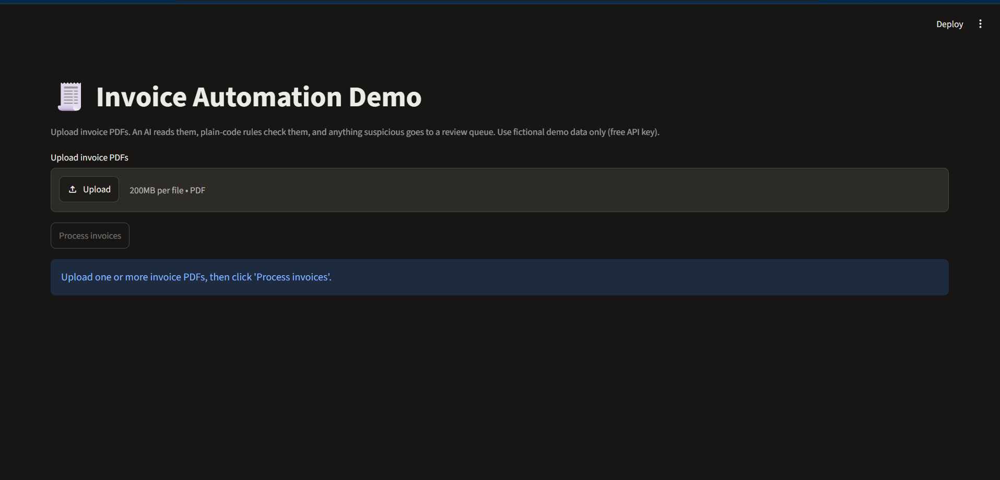
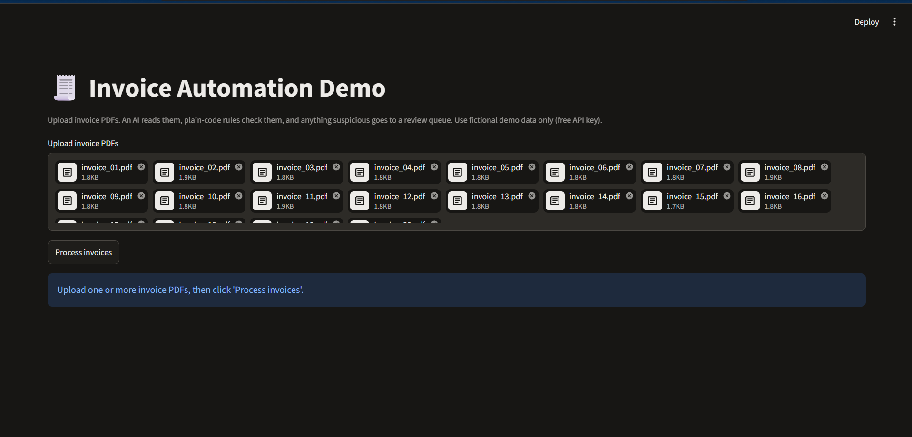
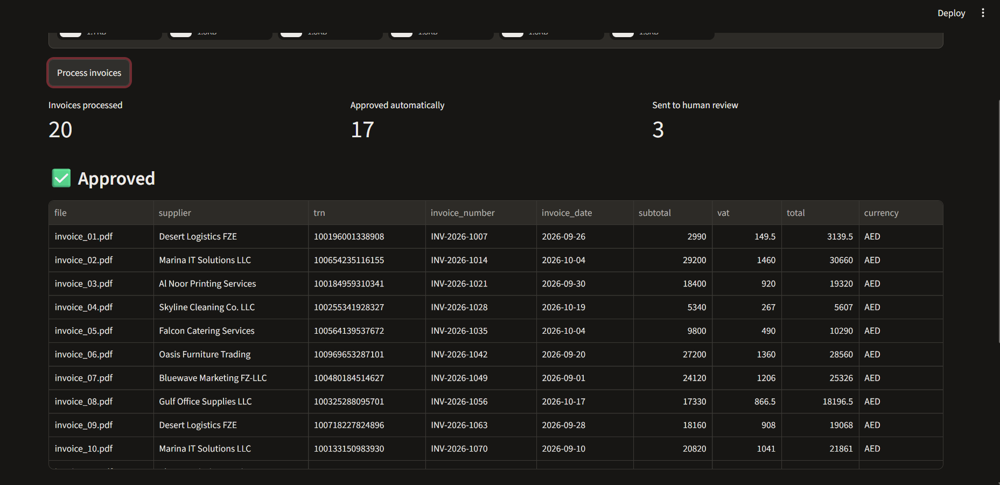
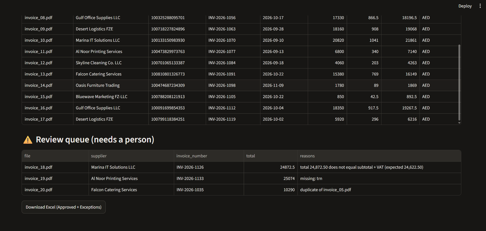
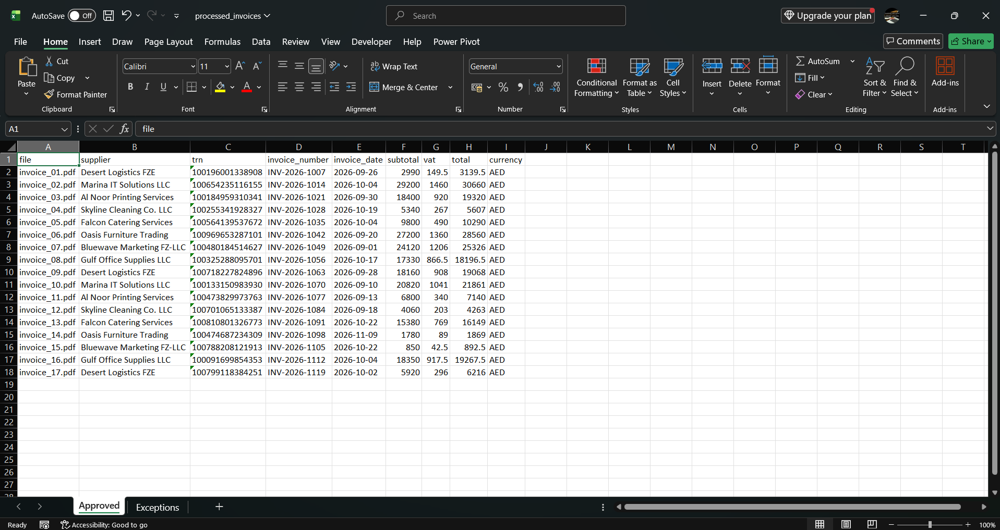
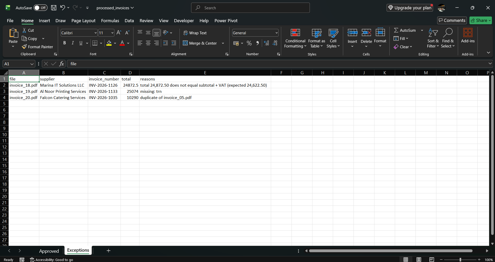

# Invoice Automation: AI Extraction + Rule-Based Validation + Review Queue

A system that reads supplier invoices (PDF), extracts the key fields with an AI model, checks them with plain-code business rules, and sends only suspicious invoices to a human review queue.

> Demo project. All companies, tax numbers and amounts are fictional and generated by a script.

## The business problem
Finance teams type invoice details into spreadsheets by hand. It is slow, and typing mistakes, wrong totals, missing tax numbers and duplicate invoices are easy to miss. A single duplicate payment or wrong VAT amount costs real money.

## What it does
- Reads invoice PDFs with different layouts (different labels, date formats and number formats)
- Extracts: supplier, tax registration number (TRN), invoice number, date, subtotal, VAT, total, currency
- Validates every invoice with exact rules and explains each problem in plain English
- Approves clean invoices automatically and sends problem invoices to a review queue
- Exports an Excel file with an **Approved** sheet and an **Exceptions** sheet

## Demo
[https://lnkd.in/p/gAs6h5FS]








## How it works
```
PDF  ->  1. Read text  ->  2. AI extracts fields (JSON)  ->  3. Rules validate  ->  Approved sheet
                                                                      |
                                                                      +-->  Review queue (a person decides)
```
1. **Read:** `pypdf` pulls the text out of each PDF.
2. **Extract:** an AI model returns the fields as JSON. The prompt tells it to use `null` for missing values, never invent a tax number, and copy numbers exactly as printed without correcting them.
3. **Clean:** plain code converts the AI reply into proper numbers, dates and empty values.
4. **Validate (no AI):** exact rules check each invoice:
   - all required fields are present
   - TRN is exactly 15 digits
   - the date is real and not in the future
   - VAT equals 5% of the subtotal, and total equals subtotal + VAT (with a small rounding tolerance)
   - currency is AED
   - the same supplier has not sent the same invoice number twice
5. **Route:** approved invoices and exceptions are exported to Excel.

## Key design decision
**AI reads, code checks.** The AI is good at understanding messy layouts. Maths and business rules must be exact and repeatable, so they are plain code. The extractor is told not to fix numbers, so the validator can catch genuine errors instead of the AI quietly hiding them.

## Results
Test data: 20 fictional invoices in 3 layouts, with the correct answers stored in `ground_truth.csv`. Three problems were planted on purpose: a wrong printed total, a missing TRN, and a duplicate invoice.

- **Extraction accuracy:** 160 of 160 fields correct (100%), 20 of 20 invoices fully correct.
- **Validation:** all 3 planted problems caught, 0 missed, 0 false alarms on the other 17 invoices.
- **Result in the app:** 20 processed, 17 approved automatically, 3 sent to review with clear reasons.
- **Testing the tests:** I also ran the validator and the evaluation on deliberately damaged data (wrong VAT, future date, invalid date, wrong currency, bad TRN, unreadable file, plus simulated AI mistakes such as an invented TRN). Each rule fired as intended, and I confirmed that one AI error can cause either a false alarm or a hidden problem, which is why extraction and validation are measured separately.

## Limitations (important)
- The data is synthetic and clean, so 100% here does **not** prove it will work on real invoices. Real invoices have scans, stamps, wrapped tables, handwriting and Arabic text.
- It reads PDFs that contain real text. Scanned images would need OCR.
- The first copy of a duplicate is approved and only later copies are flagged.
- Rules only catch what they are written for. A plausible but wrong amount would pass.
- A free LLM API is used. Do not upload real or confidential invoices.

## Next steps
- Add OCR for scanned invoices
- Test on a larger and messier set of invoices, including Arabic and multi-page documents
- Add a confidence flag so uncertain extractions go to review
- Connect approved invoices to an accounting system or database

## Tech stack
Python, pypdf, pandas, openpyxl, Streamlit, an OpenAI-compatible LLM API (Groq free tier; the provider can be swapped through settings), ReportLab for generating the fictional invoices.

## Run it yourself
```
python -m venv venv
venv\Scripts\activate
pip install -r requirements.txt
python step1_make_invoices.py
```
Set your own API key (never commit it):
```
$env:LLM_API_KEY="your_key_here"
$env:LLM_MODEL="model_name_from_your_provider"
python step2_extract.py
python step3_validate.py
python step4_evaluate_invoices.py
streamlit run step5_invoice_app.py
```

## Files
- `step1_make_invoices.py`: creates 20 fictional invoices and `ground_truth.csv`
- `step2_extract.py`: PDF text, AI extraction, cleaning
- `step3_validate.py`: business rules and review queue
- `step4_evaluate_invoices.py`: accuracy per field and validation check
- `step5_invoice_app.py`: Streamlit upload page with Excel export
- `invoices/` and `ground_truth.csv`: the fictional test data
- `sample_output/`: an example Excel export
